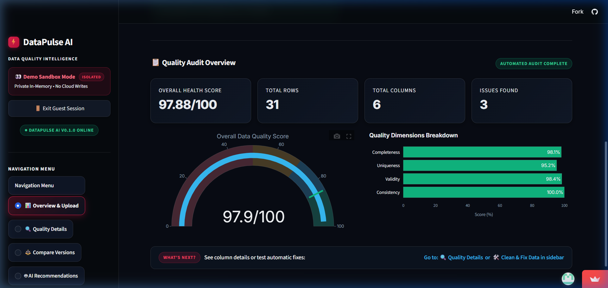
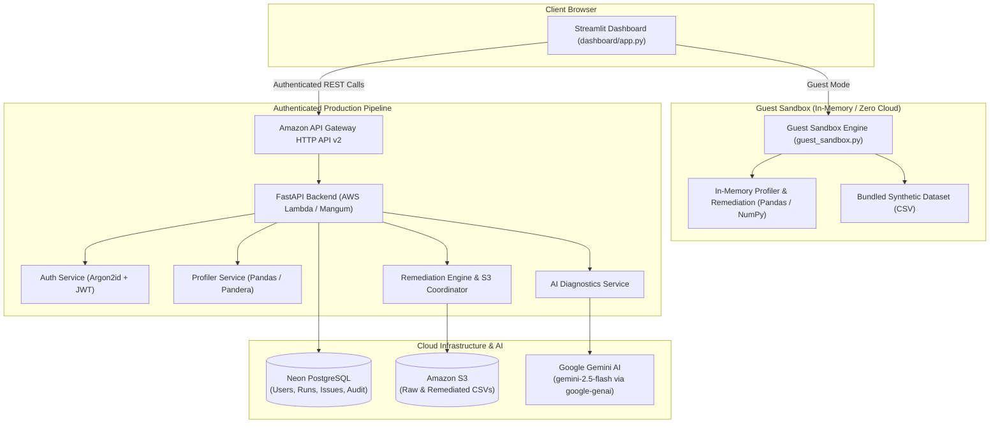

# DataPulse AI

DataPulse AI is a data quality intelligence platform for profiling datasets, detecting statistical anomalies and data quality issues, and previewing deterministic data-cleaning operations with explainable quality scores and automated revalidation.

---

## Live Demo

Experience the live interactive application:

🔗 **[https://datapulse-ai-3zy5wf7ydcwg8iljephetd.streamlit.app/](https://datapulse-ai-3zy5wf7ydcwg8iljephetd.streamlit.app/)**

> **Note**: Click **⚡ Explore Sample Data in Guest Mode** on the landing page to instantly test automated profiling, 0–100 quality scoring, and safe data remediation without needing to register or configure cloud credentials.

---

## Application Screenshot



*The DataPulse AI dashboard displaying an automated quality audit, deterministic 0–100 health score radial gauge, and multi-dimensional quality breakdowns.*

---

## Key Features

- **Robust CSV Ingestion**: Validates multipart uploads, detects encoding (UTF-8, Latin-1 fallback), flags duplicate headers, prevents path-traversal attacks, and enforces size/row limits.
- **Automated Statistical Profiling**: Computes row and column counts, missing rates, duplicate rates, numeric quartiles, Interquartile Range (IQR) outliers ($[Q_1 - 1.5 \times \text{IQR}, Q_3 + 1.5 \times \text{IQR}]$), string length distributions, date-validity parsing, and candidate primary key detection.
- **Deterministic 0–100 Quality Scoring**: Calculates a transparent score across four core dimensions—**Completeness** (40%), **Uniqueness** (20%), **Validity** (25%), and **Consistency** (15%)—with itemized, human-readable deductions.
- **Categorized Issue Detection**: Automatically aggregates detected defects into standardized severities (`critical`, `high`, `medium`, `low`) covering missing data, duplicate records, invalid date formats, empty/constant columns, and Pandera schema discrepancies.
- **Deterministic Remediation Previews**: Simulates data corrections on DataFrame deep copies (`df.copy(deep=True)`). Supports missing value imputation (`mean`, `median`, `mode`, `constant`), duplicate row dropping, whitespace trimming, empty string normalization, data type coercion (`reject` or `preserve_as_null`), and numeric outlier capping.
- **Cryptographic Preview Tokens & Source Immutability**: Binds proposed operations to a 24-character SHA-256 preview token (`prev_{run_id}_{hash}`). The original CSV in Amazon S3 is never overwritten; approved corrections are written to a dedicated S3 object key (`_remediated.csv`) as a new dataset version.
- **Automated Revalidation**: Automatically re-profiles corrected datasets upon application to compute empirical score improvement ($\Delta$), resolved issues, and remaining defects.
- **AI-Powered Diagnostics & Remediation Intelligence**: Integrates **Google Gemini AI** (using the official `google-genai` SDK with `gemini-2.5-flash`) to generate explainable root-cause analyses, dataset health summaries, and actionable remediation strategies with itemized trade-offs. Distinguishes verified statistical facts from hypotheses (`is_hypothesis: true`), and strictly separates recommendations from deterministic execution.
- **Human-in-the-Loop Remediation**: AI models only propose changes; all data transformations are executed deterministically with explicit user approval, cryptographic preview tokens, and comprehensive audit history.
- **Multi-Tenant Authentication & Ownership**: Secure user registration and login with Argon2id password hashing, algorithm-pinned JWTs (`HS256`), and per-user dataset isolation.
- **Isolated Guest Sandbox Mode**: A 100% in-memory profiling and remediation engine bundled with synthetic customer order data, allowing immediate exploration with zero database or AWS dependencies.

---

## Architecture

DataPulse AI supports two execution paths: an authenticated cloud-backed pipeline (FastAPI + Neon PostgreSQL + Amazon S3) and an isolated, in-memory guest sandbox for demonstration:



---

## Tech Stack

| Domain | Technologies |
| :--- | :--- |
| **Frontend & UI** | [Streamlit](https://streamlit.io/), [Plotly](https://plotly.com/), Custom Vanilla CSS Design System |
| **Backend API** | [FastAPI](https://fastapi.tiangolo.com/), [Pydantic v2](https://docs.pydantic.dev/), [Uvicorn](https://www.uvicorn.org/), [Mangum](https://mangum.io/) (ASGI adapter for AWS Lambda) |
| **Data Processing** | [Pandas](https://pandas.pydata.org/), [NumPy](https://numpy.org/), [Pandera](https://unionai-oss.github.io/pandera/) |
| **Database & Storage** | [PostgreSQL (Neon)](https://neon.tech/), [SQLAlchemy 2.0](https://www.sqlalchemy.org/), [Alembic](https://alembic.sqlalchemy.org/), [Amazon S3 (Boto3)](https://aws.amazon.com/s3/) |
| **Security & Auth** | [Argon2id (`argon2-cffi`)](https://pypi.org/project/argon2-cffi/), [PyJWT](https://pyjwt.readthedocs.io/) (`HS256` pinned) |
| **AI Diagnostics** | [Google Gen AI SDK](https://github.com/googleapis/python-genai) (`google-genai`), Google Gemini (`gemini-2.5-flash`), HTTPX fallback |
| **Deployment & CI/CD** | [Docker](https://www.docker.com/), [AWS Lambda](https://aws.amazon.com/lambda/), [Amazon API Gateway](https://aws.amazon.com/api-gateway/), [Jenkins](https://www.jenkins.io/) (`Jenkinsfile`) |

---

## Project Structure

```
DataPulse-AI/
├── app/
│   ├── api/              # REST endpoints (auth, datasets, profiling, health)
│   ├── core/             # Database pooling, Pydantic settings, Argon2/JWT security
│   ├── models/           # SQLAlchemy models (User, Dataset, ProfilingRun, Issue, AuditLog)
│   ├── schemas/          # Pydantic request and response schemas
│   ├── services/         # Statistical profiler, remediation engine, S3, & AI services
│   ├── lambda_handler.py # AWS Lambda Mangum handler with CORS injection
│   └── main.py           # FastAPI application factory and lifespan hooks
├── dashboard/
│   ├── api_client.py     # HTTP client consuming backend REST endpoints
│   ├── app.py            # Streamlit multi-view analytics application
│   ├── auth_page.py      # Authentication and guest mode onboarding view
│   ├── components.py     # Plotly score gauges, defect charts, and metric cards
│   ├── guest_sandbox.py  # Zero-dependency, in-memory guest profiling engine
│   └── theme.py          # Dark SaaS styling, design system, and custom CSS
├── docs/
│   ├── images/           # Dashboard screenshots and visual documentation
│   └── DEPLOYMENT_AWS.md # Production AWS CLI deployment guide (ap-south-1)
├── sample_data/          # Bundled synthetic customer orders dataset
├── tests/                # 160 automated tests with offline SQLite & mock providers
├── Dockerfile            # Multi-stage Linux container image for AWS Lambda
├── Jenkinsfile           # CI/CD pipeline with automated testing and deployment gates
├── requirements.txt      # Complete application dependencies
└── template.yaml         # AWS SAM infrastructure definition
```

---

## Run Locally (Windows PowerShell)

### 1. Clone the Repository
```powershell
git clone https://github.com/Kavyansh180/DataPulse-AI.git
cd DataPulse-AI
```

### 2. Create and Activate Virtual Environment
```powershell
python -m venv .venv
.\.venv\Scripts\Activate.ps1
```

### 3. Install Dependencies
```powershell
pip install -r requirements.txt
```

### 4. Configure Environment Variables
Copy the template and configure your local settings:
```powershell
Copy-Item .env.example .env
```
*(Optional: For running the Guest Sandbox mode locally, no cloud credentials or database configurations are required.)*

### 5. Launch the Application

#### Option A: Run the Streamlit Dashboard (Includes Guest Sandbox)
```powershell
streamlit run dashboard/app.py
```
Open **[http://localhost:8501](http://localhost:8501)** in your browser.

#### Option B: Run the FastAPI Backend (Requires PostgreSQL Database)
Apply migrations and start the Uvicorn server:
```powershell
alembic upgrade head
uvicorn app.main:app --reload --host 127.0.0.1 --port 8000
```
- API Server: [http://127.0.0.1:8000](http://127.0.0.1:8000)
- Interactive Swagger Docs: [http://127.0.0.1:8000/docs](http://127.0.0.1:8000/docs)
- Health Check: [http://127.0.0.1:8000/health](http://127.0.0.1:8000/health)

---

## Automated Testing

DataPulse AI includes a test suite using isolated SQLite test doubles and mocked LLM providers, allowing the entire suite to run offline without live database or cloud secrets:

```powershell
pytest -v
```

**Test Verification Status**:
```
======================= 160 passed, 1 warning in 11.29s =======================
```

The 160 automated tests cover:
- JWT generation, expiration, signature tampering, and algorithm pinning
- Password hashing with Argon2id and user registration/login flows
- Pure Pandas statistical profiling, IQR outlier bounds, and score edge cases
- Cryptographic remediation preview tokens, tamper rejection, and data immutability
- Deep-copy remediation transformations (imputation, deduplication, casting, capping)
- Google Gemini AI integration: SDK provider handling, rate limits (429), timeouts, auth errors, and response formatting
- Privacy safeguards: redaction of sensitive columns (`password`, `token`, `ssn`, `secret`) and suppression of raw tabular row transmission
- AI recommendation trade-off schemas and human-in-the-loop preview isolation
- AWS Lambda Mangum handler initialization and CORS headers
- Guest sandbox isolation under invalid or missing database configurations, with graceful AI fallback

---

## Security & Isolation Notes

- **Guest Sandbox Isolation**: In Guest Mode, all profiling, calculations, and remediation transformations execute **100% in-memory** on local pandas DataFrames. No data is sent to external APIs, written to Neon PostgreSQL, or stored in Amazon S3. If `GEMINI_API_KEY` is not present, the sandbox gracefully displays a pre-computed diagnostic report without raising errors or crashing.
- **Privacy by Design (AI Diagnostics)**: Gemini receives **only** aggregated dataset statistics (row counts, null percentages, IQR outlier counts, column datatypes). Raw row values, CSV files, credentials, and sensitive column names matching patterns like `token`, `password`, `ssn`, or `secret` are automatically masked and never transmitted to the LLM.
- **Production Secrets**: Do not commit `.env` files or hardcode cloud credentials. Production deployments pull credentials securely via environment variables or AWS Systems Manager (SSM) Parameter Store (`/datapulse/production/GEMINI_API_KEY`).
- **Data Immutability & Determinism**: All remediation workflows strictly prohibit in-place mutation of uploaded raw CSV files. AI cannot execute remediation directly; every applied remediation requires explicit user approval, cryptographic preview token verification, and results in an independent, version-tagged S3 object with an immutable audit log record.
- **Payload & File Guards**: Multipart uploads are restricted by size limits (10 MB via API Gateway, 50 MB application cap), filename sanitization, and encoding validation to prevent buffer exhaustion and path-traversal exploits.
